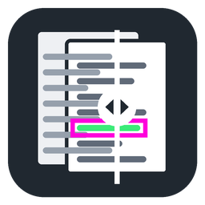

# PdfCompare

Visual PDF and image comparison for Windows: drop two PDFs or images, see what
changed, page by page.

**[⬇ Download PdfCompare.exe](https://github.com/KrustyLeBot/PdfCompare/releases/latest/download/PdfCompare.exe)**
— single file, no installation, no Python needed (~67 MB).



## Features

- **Drop two PDFs or images on the window.** The view splits in two: the left half
  loads the *before* file, the right half the *after* one. The panel tells you which file is
  still missing, and an **Swap** button fixes a mix-up.
- **Wipe view (default).** Both pages superposed with a divider you drag left and
  right, so a change jumps out immediately.
- **Overlay view.** Identical pixels become transparent; removed ink is red, added
  ink is green, modified ink is yellow. A configurable radius of context around
  each change stays faintly visible so you can locate it on the page.
- **Every changed area is boxed in magenta**, in all views.
- **Continuous scrolling** through the whole document (or page-by-page), with a
  page list marking which pages differ and by how much. "Changed pages only"
  restricts both the list and the scroll strip.
- **Images too**: PNG, JPEG, BMP, GIF, TIFF and WebP, compared pixel for pixel
  at the default 200 dpi. Multi-frame TIFF and GIF give one page per frame, the
  EXIF rotation of photos is applied, and transparency is shown on white. A PDF
  can be compared with an image.
- **Multipage aware**: different page counts (pages added/removed) and different
  page sizes are reported instead of being silently mangled.
- **Nothing is written to disk** unless you press the save button (PNG of the
  current page, full resolution).
- Interface in **English or French**, following the system language (English by
  default). Force it with `PDFCOMPARE_LANG=fr` or `PDFCOMPARE_LANG=en`.

## Controls

| Action | Input |
| --- | --- |
| Wipe before/after | drag the round handle, or `←` / `→` |
| Scroll | wheel, `PgUp` / `PgDn`, scrollbars, drag anywhere |
| Zoom | `Ctrl`+wheel (zooms at the pointer), `-` / `1:1` / `+`, `fit` |
| Reset the view | double-click |
| Go to a page | click it in the list, or `Home` for the first one |

## Options

`dpi` render resolution — defaults to 200, or to the native resolution of PDF 1
when it is a scan (clamped to 96-300); images use 200, where one image pixel is
one rendered pixel ·
`threshold` per-channel difference (0-255) above which a pixel counts as changed ·
`radius` context kept around each change, in points · `min area` discards blobs
smaller than N pixels (anti-aliasing noise) · `background` checkerboard / black /
white for the transparent parts.

## Running from source

```bash
pip install pymupdf pillow numpy tkinterdnd2
python PdfCompare.py
```

`tkinterdnd2` is only needed for drag and drop; without it the rest of the app
works and the file pickers stay available.

## Rebuilding the exe

A push to `main` that touches `PdfCompare.py` or `icon.ico` rebuilds the exe on a
Windows runner (`.github/workflows/build-exe.yml`) and publishes it as a new
release (`build-N`, the latest one is always at
[releases/latest](https://github.com/KrustyLeBot/PdfCompare/releases/latest)).
The exe is not committed to the repository. Run the workflow by hand from the Actions tab to force a
rebuild. To build locally:

```bash
pip install pyinstaller
python -m PyInstaller --noconfirm --onefile --windowed --name PdfCompare --icon icon.ico --add-data "icon.ico;." --collect-all tkinterdnd2 --distpath dist PdfCompare.py
```

The icon is generated by `python make_icon.py` (only needed if you change it;
`icon.ico` is committed).

## How it works

Both PDFs are rasterised with PyMuPDF, then compared pixel by pixel. An image is
first wrapped in an in-memory PDF (one page per frame) whose page size is its
pixel size at 200 dpi, whatever dpi its metadata declares, so two images of the
same pixel size always line up. The changed
mask is dilated by the context radius (separable doubling shifts over the mask
bounding box, so a page costs a few milliseconds instead of seconds), and
8-connected components on a coarse block grid give the bounding boxes.

A first low-resolution pass (72 dpi) flags which pages differ, which fills the
page list instantly. Full-resolution pages are then computed by a background
worker — visible pages first, then a prefetch of the rest — and cached under a
400 MB ceiling. Painting is viewport-based: only the visible slice of each page is
cropped and scaled, so cost is independent of the zoom and of the document length.
Interactive frames use a nearest-neighbour rescale and a full-quality repaint
follows once you stop moving.
